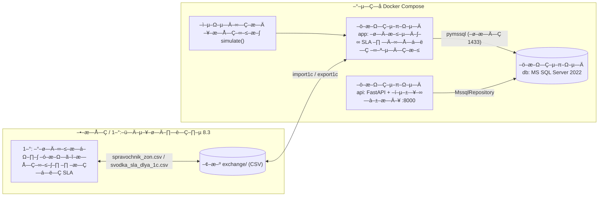

# –ú–æ–¥—É–ª—å –∫–æ–Ω—Ç—Ä–æ–ª—è —Å–æ–±–ª—é–¥–µ–Ω–∏—è SLA –ø–æ –¥–æ—Å—Ç–∞–≤–∫–µ —Å –∞–≥—Ä–µ–≥–∞—Ü–∏–µ–π –º–µ—Ç—Ä–∏–∫, –∞–ª–µ—Ä—Ç–∞–º–∏ –∏ –¥–∞—à–±–æ—Ä–¥–∞–º–∏ (–¢–µ–º–∞ ‚Ññ11)

Курсовой проект по МДК 02.02 «Инструментальные средства разработки программного обеспечения» (специальность 09.07.02 «Информационные системы и программирование», группа ИСП 41).

Система принимает поток событий доставки заказов, проверяет корректность и согласованность данных (диапазоны времени, нормативов, дистанции, средней скорости и временных меток), рассчитывает соблюдение нормативов SLA по зонам доставки, формирует алерты (`WARNING` / `CRITICAL`) при превышении допустимого времени, сохраняет данные в Microsoft SQL Server, обменивается справочниками и сводками с «1С:Предприятие 8.3» через CSV и HTTP, а также предоставляет REST API и веб-дашборд на FastAPI.

## 1. –°–ª–æ–∏ —Å–∏—Å—Ç–µ–º—ã –∏ –∞—Ä—Ö–∏—Ç–µ–∫—Ç—É—Ä–∞

| –°–ª–æ–π | –ù–∞–∑–Ω–∞—á–µ–Ω–∏–µ –≤ —Ç–µ–º–µ ‚Ññ11 | –ì–¥–µ –Ω–∞—Ö–æ–¥–∏—Ç—Å—è –≤ –ø—Ä–æ–µ–∫—Ç–µ |
| :--- | :--- | :--- |
| **–í—Ö–æ–¥** | –ì–µ–Ω–µ—Ä–∞—Ç–æ—Ä –ø–æ—Ç–æ–∫–∞ –¥–æ—Å—Ç–∞–≤–æ–∫ —Å –∫–æ–Ω—Ç—Ä–æ–ª–∏—Ä—É–µ–º—ã–º `--seed`, CSV-—Ñ–∞–π–ª—ã –æ–±–º–µ–Ω–∞ –∏–∑ 1–° –∏ HTTP POST –∑–∞–ø—Ä–æ—Å—ã `/shipments` | `simulate()` –≤ `app/main.py`, `integration/api.py`, `integration/http_client.py` |
| **–ü—Ä–æ–≤–µ—Ä–∫–∞** | –ß–∏—Å—Ç—ã–µ —Ñ—É–Ω–∫—Ü–∏–∏ –∫–æ–Ω—Ç—Ä–æ–ª—è –≥—Ä–∞–Ω–∏—Ü –≤—Ä–µ–º–µ–Ω–∏ `[1; 1440]` –º–∏–Ω, –Ω–æ—Ä–º–∞—Ç–∏–≤–∞ `[10; 720]` –º–∏–Ω, –¥–∏—Å—Ç–∞–Ω—Ü–∏–∏ `[0.1; 500]` –∫–º, —Å–∫–æ—Ä–æ—Å—Ç–∏ `<= 150` –∫–º/—á –∏ –≤—Ä–µ–º–µ–Ω–∏ –Ω–µ –∏–∑ –±—É–¥—É—â–µ–≥–æ | `app/validate.py`, `integration/rules.py` |
| **–†–∞—Å—á—ë—Ç –∏ –ø—Ä–∞–≤–∏–ª–∞** | –†–∞—Å—á—ë—Ç –æ–ø–æ–∑–¥–∞–Ω–∏—è `delay_min`, —Å—Ç–∞—Ç—É—Å–∞ `sla_met`, –∫–ª–∞—Å—Å–∏—Ñ–∏–∫–∞—Ü–∏—è –∞–ª–µ—Ä—Ç–æ–≤ (`WARNING` / `CRITICAL`) –∏ —Ä–∞—Å—á—ë—Ç `% —Å–æ–±–ª—é–¥–µ–Ω–∏—è SLA` –ø–æ –∑–æ–Ω–∞–º | `evaluate_sla()` –≤ `app/validate.py`, `evaluate_alert()` –≤ `integration/rules.py`, `REPORT_SQL` |
| **–•—Ä–∞–Ω–µ–Ω–∏–µ** | –¢–∞–±–ª–∏—Ü—ã `dbo.delivery_zone`, `dbo.shipment_event`, `dbo.sla_alert`, `dbo.rejected_event` –≤ Microsoft SQL Server 2022 + `InMemoryRepository` | `db/init.sql`, `app/db.py`, `integration/repository.py` |
| **–û—Ç—á—ë—Ç, –∞–ª–µ—Ä—Ç—ã –∏ –¥–∞—à–±–æ—Ä–¥** | –ö–æ–Ω—Å–æ–ª—å–Ω–∞—è —Ç–∞–±–ª–∏—Ü–∞ SLA, –≤—ã–≥—Ä—É–∑–∫–∞ —Å–≤–æ–¥–∫–∏ `exchange/svodka_sla_dlya_1c.csv` –¥–ª—è 1–°, JSON API `/shipments/summary`, `/alerts` –∏ HTML-–¥–∞—à–±–æ—Ä–¥ `/dashboard` | `cmd_report()`, `cmd_export1c()` –≤ `app/main.py`, `integration/api.py` |
| **–ê–≤—Ç–æ—Ç–µ—Å—Ç—ã –∏ CI/CD** | –ú–æ–¥—É–ª—å–Ω—ã–µ, –ø–∞—Ä–∞–º–µ—Ç—Ä–∏–∑–æ–≤–∞–Ω–Ω—ã–µ, –∞–¥–∞–ø—Ç–µ—Ä–Ω—ã–µ –∏ –∏–Ω—Ç–µ–≥—Ä–∞—Ü–∏–æ–Ω–Ω—ã–µ —Ç–µ—Å—Ç—ã (`pytest`), –ø—Ä–æ–≤–µ—Ä–∫–∞ —Å—Ç–∏–ª—è (`flake8`), –∫–æ–Ω–≤–µ–π–µ—Ä GitLab CI | `tests/`, `.gitlab-ci.yml` |

### –°—Ö–µ–º–∞ –∞—Ä—Ö–∏—Ç–µ–∫—Ç—É—Ä—ã (Mermaid)



## 2. –ß—Ç–æ –Ω—É–∂–Ω–æ —É—Å—Ç–∞–Ω–æ–≤–∏—Ç—å

- **Docker Desktop** (с включённым WSL 2 на Windows; выделить не менее 3–4 ГБ ОЗУ для контейнера SQL Server)
- **Visual Studio Code** (—Ä–µ–∫–æ–º–µ–Ω–¥—É–µ–º—ã–µ —Ä–∞—Å—à–∏—Ä–µ–Ω–∏—è –æ–ø–∏—Å–∞–Ω—ã –≤ `.vscode/extensions.json`)
- **Git** (–¥–ª—è –∫–ª–æ–Ω–∏—Ä–æ–≤–∞–Ω–∏—è –∏ —Ä–∞–±–æ—Ç—ã —Å GitLab)
- **Python 3.10+** (–ø—Ä–∏ –ª–æ–∫–∞–ª—å–Ω–æ–º –∑–∞–ø—É—Å–∫–µ –≤–Ω–µ –∫–æ–Ω—Ç–µ–π–Ω–µ—Ä–∞)

## 3. –ö–∞–∫ –∑–∞–ø—É—Å—Ç–∏—Ç—å –ø—Ä–æ–µ–∫—Ç —Å –Ω—É–ª—è (–ø—Ä–æ–≤–µ—Ä–∫–∞ —á–∏—Å—Ç–æ–≥–æ –∫–ª–æ–Ω–∞)

```bash
git clone <–∞–¥—Ä–µ—Å_—Ä–µ–ø–æ–∑–∏—Ç–æ—Ä–∏—è> check
cd check
cp .env.example .env
docker compose up --build --abort-on-container-exit
```

–ü—Ä–∏ –∑–∞–ø—É—Å–∫–µ `docker compose up --build --abort-on-container-exit` –∞–≤—Ç–æ–º–∞—Ç–∏—á–µ—Å–∫–∏ –ø–æ–¥–Ω–∏–º–∞–µ—Ç—Å—è –∫–æ–Ω—Ç–µ–π–Ω–µ—Ä `db` (Microsoft SQL Server 2022), –¥–æ–∂–∏–¥–∞–µ—Ç—Å—è —Å—Ç–∞—Ç—É—Å–∞ `healthy`, –ø–æ—Å–ª–µ —á–µ–≥–æ –∫–æ–Ω—Ç–µ–π–Ω–µ—Ä `app` –≤—ã–ø–æ–ª–Ω—è–µ—Ç –ø–æ–ª–Ω—ã–π —Å–∫–≤–æ–∑–Ω–æ–π —Å—Ü–µ–Ω–∞—Ä–∏–π (`run-all`):
1. `init` — применяет идемпотентную схему `db/init.sql` (создаёт базу `sla_delivery` и 4 таблицы).
2. `import1c` — загружает справочник зон доставки из `exchange/spravochnik_zon.csv`.
3. `ingest` — генерирует поток из 200 доставок, отсеивает некорректные записи в `dbo.rejected_event`, сохраняет валидные в `dbo.shipment_event` и создаёт алерты в `dbo.sla_alert`.
4. `report` — выводит сводную таблицу соблюдения SLA по зонам в консоль.
5. `export1c` — формирует итоговую выгрузку `exchange/svodka_sla_dlya_1c.csv` для 1С.

### –ó–∞–ø—É—Å–∫ –≤–µ–±-—Å–µ—Ä–≤–∏—Å–∞ –∏ –¥–∞—à–±–æ—Ä–¥–∞ FastAPI

```bash
docker compose up -d db api
```

–ü–æ—Å–ª–µ –∑–∞–ø—É—Å–∫–∞ –æ—Ç–∫—Ä–æ–π—Ç–µ –≤ –±—Ä–∞—É–∑–µ—Ä–µ:
- –ò–Ω—Ç–µ—Ä–∞–∫—Ç–∏–≤–Ω—ã–π –¥–∞—à–±–æ—Ä–¥ SLA –∏ –∞–ª–µ—Ä—Ç–æ–≤: `http://localhost:8000/dashboard`
- –î–æ–∫—É–º–µ–Ω—Ç–∞—Ü–∏—è Swagger UI: `http://localhost:8000/docs`

## 4. –ö–∞–∫ –∑–∞–ø—É—Å—Ç–∏—Ç—å –∞–≤—Ç–æ—Ç–µ—Å—Ç—ã –∏ –ª–∏–Ω—Ç–µ—Ä

```bash
# –ú–æ–¥—É–ª—å–Ω—ã–µ –∏ –∞–¥–∞–ø—Ç–µ—Ä–Ω—ã–µ —Ç–µ—Å—Ç—ã –±–µ–∑ –∑–∞–ø—É—Å–∫–∞ –°–£–ë–î (23 —Ç–µ—Å—Ç–∞)
docker compose run --rm --no-deps app pytest -v

# –ò–Ω—Ç–µ–≥—Ä–∞—Ü–∏–æ–Ω–Ω—ã–µ —Ç–µ—Å—Ç—ã –Ω–∞ –∂–∏–≤–æ–π –±–∞–∑–µ SQL Server (–≤—Å–µ 25 —Ç–µ—Å—Ç–æ–≤)
docker compose up -d db
docker compose run --rm -e RUN_DB_TESTS=1 app python -m app.main init
docker compose run --rm -e RUN_DB_TESTS=1 app pytest -v

# –ü—Ä–æ–≤–µ—Ä–∫–∞ —Å—Ç–∏–ª—è –∫–æ–¥–∞ –ª–∏–Ω—Ç–µ—Ä–æ–º flake8
docker compose run --rm --no-deps app flake8 app integration tests --max-line-length=120
```

## 5. –°—Ç—Ä—É–∫—Ç—É—Ä–∞ –ø—Ä–æ–µ–∫—Ç–∞

```text
sla_delivery_project/
  app/                          # –ö–æ–Ω—Å–æ–ª—å–Ω–æ–µ –ø—Ä–∏–ª–æ–∂–µ–Ω–∏–µ (–ú–µ—Ç–æ–¥–∏—á–∫–∏ 1-6)
    config.py                   # –ß—Ç–µ–Ω–∏–µ –Ω–∞—Å—Ç—Ä–æ–µ–∫ –∏–∑ –ø–µ—Ä–µ–º–µ–Ω–Ω—ã—Ö –æ–∫—Ä—É–∂–µ–Ω–∏—è
    validate.py                 # –ß–∏—Å—Ç—ã–µ —Ñ—É–Ω–∫—Ü–∏–∏ –≤–∞–ª–∏–¥–∞—Ü–∏–∏ –∏ —Ä–∞—Å—á—ë—Ç–∞ SLA/–∞–ª–µ—Ä—Ç–æ–≤
    db.py                       # –ü–æ–¥–∫–ª—é—á–µ–Ω–∏–µ –∫ SQL Server —Å –ø–æ–≤—Ç–æ—Ä–∞–º–∏ –∏ –∑–∞–ø—É—Å–∫–æ–º init.sql
    main.py                     # –ö–æ–º–∞–Ω–¥—ã: init, ingest, report, import1c, export1c, run-all
  integration/                  # –°–ª–æ–∏—Å—Ç–∞—è –∞—Ä—Ö–∏—Ç–µ–∫—Ç—É—Ä–∞ –∏ –≤–µ–±-—Å–µ—Ä–≤–∏—Å (–ë–æ–ª—å—à–∞—è –º–µ—Ç–æ–¥–∏—á–∫–∞)
    settings.py                 # –ù–µ–∏–∑–º–µ–Ω—è–µ–º—ã–π dataclass Settings.from_env()
    domain.py                   # –ü—Ä–µ–¥–º–µ—Ç–Ω—ã–µ –æ–±—ä–µ–∫—Ç—ã ShipmentReading, SlaAlertRecord, ZoneSlaSummary
    rules.py                    # –ß–∏—Å—Ç—ã–µ –±–∏–∑–Ω–µ—Å-–ø—Ä–∞–≤–∏–ª–∞ –ø—Ä–æ–≤–µ—Ä–∫–∏ –∏ –≥–µ–Ω–µ—Ä–∞—Ü–∏–∏ –∞–ª–µ—Ä—Ç–æ–≤
    repository.py               # –ü—Ä–æ—Ç–æ–∫–æ–ª —Ö—Ä–∞–Ω–∏–ª–∏—â–∞, InMemoryRepository –∏ MssqlRepository
    service.py                  # –°—Ü–µ–Ω–∞—Ä–∏–π –ø—Ä–∏—ë–º–∞ —Å –≤–Ω–µ–¥—Ä–µ–Ω–∏–µ–º –∑–∞–≤–∏—Å–∏–º–æ—Å—Ç–µ–π (ingest)
    http_client.py              # HTTP-–∫–ª–∏–µ–Ω—Ç —Å–ø—Ä–∞–≤–æ—á–Ω–∏–∫–∞ 1–° —Å —Ç–∞–π–º–∞—É—Ç–∞–º–∏ –∏ –ø–æ–≤—Ç–æ—Ä–∞–º–∏
    api.py                      # –í–µ–±-–∏–Ω—Ç–µ—Ä—Ñ–µ–π—Å FastAPI (/shipments, /alerts, /dashboard)
    server.py                   # –¢–æ—á–∫–∞ —Å–±–æ—Ä–∫–∏ –ø—Ä–∏–ª–æ–∂–µ–Ω–∏—è –¥–ª—è uvicorn
  db/
    init.sql                    # –ò–¥–µ–º–ø–æ—Ç–µ–Ω—Ç–Ω–∞—è —Å—Ö–µ–º–∞ –ë–î SQL Server –∏ –Ω–∞—á–∞–ª—å–Ω—ã–µ –¥–∞–Ω–Ω—ã–µ
    queries.sql                 # –û—Ç—á—ë—Ç–Ω—ã–µ SQL-–∑–∞–ø—Ä–æ—Å—ã –∏ –∫–æ–º–∞–Ω–¥—ã BACKUP / RESTORE
    schema.dbml                 # –û–ø–∏—Å–∞–Ω–∏–µ ER-–¥–∏–∞–≥—Ä–∞–º–º—ã –¥–ª—è dbdiagram.io
  exchange/
    spravochnik_zon.csv         # –û–±—Ä–∞–∑–µ—Ü –≤—ã–≥—Ä—É–∑–∫–∏ —Å–ø—Ä–∞–≤–æ—á–Ω–∏–∫–∞ –∑–æ–Ω –¥–æ—Å—Ç–∞–≤–∫–∏ –∏–∑ 1–°
    1c_obrabotka_obmen.bsl      # –ö–æ–¥ –≤–Ω–µ—à–Ω–µ–π –æ–±—Ä–∞–±–æ—Ç–∫–∏ –∏ HTTP-—Å–µ—Ä–≤–∏—Å–∞ –¥–ª—è 1–°:–ü—Ä–µ–¥–ø—Ä–∏—è—Ç–∏–µ 8.3
  tests/                        # –ê–≤—Ç–æ—Ç–µ—Å—Ç—ã (—è–¥—Ä–æ, –≥—Ä–∞–Ω–∏—á–Ω—ã–µ —Å–ª—É—á–∞–∏, HTTP-–∫–ª–∏–µ–Ω—Ç, FastAPI, MSSQL)
  .gitlab/                      # –®–∞–±–ª–æ–Ω—ã Merge Request –∏ Issue –¥–ª—è GitLab
  .vscode/                      # –ó–∞–¥–∞—á–∏ (tasks.json) –∏ —Ä–∞—Å—à–∏—Ä–µ–Ω–∏—è (extensions.json) –¥–ª—è VS Code
  Dockerfile                    # –†–µ—Ü–µ–ø—Ç —Å–±–æ—Ä–∫–∏ Docker-–æ–±—Ä–∞–∑–∞ –ø—Ä–∏–ª–æ–∂–µ–Ω–∏—è
  docker-compose.yml            # –û—Ä–∫–µ—Å—Ç—Ä–∞—Ü–∏—è –∫–æ–Ω—Ç–µ–π–Ω–µ—Ä–æ–≤ db, app –∏ api
  .gitlab-ci.yml                # –ö–æ–Ω–≤–µ–π–µ—Ä CI/CD (—Å—Ç–∞–¥–∏–∏ lint –∏ test)
  requirements.txt              # –ó–∞–∫—Ä–µ–ø–ª—ë–Ω–Ω—ã–µ –≤–µ—Ä—Å–∏–∏ —Å—Ç–æ—Ä–æ–Ω–Ω–∏—Ö –±–∏–±–ª–∏–æ—Ç–µ–∫
```

## 6. –§–æ—Ä–º–∞—Ç —Ñ–∞–π–ª–æ–≤ –æ–±–º–µ–Ω–∞ —Å 1–° –∏ —Å—Ö–µ–º–∞ –ë–î

### –§–æ—Ä–º–∞—Ç –≤—Ö–æ–¥–Ω–æ–≥–æ —Å–ø—Ä–∞–≤–æ—á–Ω–∏–∫–∞ (`exchange/spravochnik_zon.csv`)
- **–†–∞–∑–¥–µ–ª–∏—Ç–µ–ª—å:** —Ç–æ—á–∫–∞ —Å –∑–∞–ø—è—Ç–æ–π `;`
- **–ö–æ–¥–∏—Ä–æ–≤–∫–∞:** `UTF-8` (–ø–æ–¥–¥–µ—Ä–∂–∏–≤–∞–µ—Ç—Å—è BOM —á–µ—Ä–µ–∑ `utf-8-sig`)
- **–ï—Å—Ç–µ—Å—Ç–≤–µ–Ω–Ω—ã–π –∫–ª—é—á:** –∫–æ–ª–æ–Ω–∫–∞ `–ö–æ–¥` (–Ω–æ—Ä–º–∞–ª–∏–∑—É–µ—Ç—Å—è —á–µ—Ä–µ–∑ `.strip().upper()`)
- **–ö–æ–ª–æ–Ω–∫–∏:** `–ö–æ–¥;–ù–∞–∏–º–µ–Ω–æ–≤–∞–Ω–∏–µ;–ù–æ—Ä–º–∞—Ç–∏–≤–ú–∏–Ω;–ö—Ä–∏—Ç–û–ø–æ–∑–¥–∞–Ω–∏–µ–ú–∏–Ω`

### –§–æ—Ä–º–∞—Ç –≤—ã–≥—Ä—É–∂–∞–µ–º–æ–π —Å–≤–æ–¥–∫–∏ (`exchange/svodka_sla_dlya_1c.csv`)
- **–ö–æ–ª–æ–Ω–∫–∏:** `–ö–æ–¥;–ù–∞–∏–º–µ–Ω–æ–≤–∞–Ω–∏–µ;–í—Å–µ–≥–æ–î–æ—Å—Ç–∞–≤–æ–∫;–í_–°—Ä–æ–∫;–ù–∞—Ä—É—à–µ–Ω–∏–π_SLA;–ü—Ä–æ—Ü–µ–Ω—Ç_SLA;–°—Ä–µ–¥–Ω–µ–µ–í—Ä–µ–º—è–ú–∏–Ω;–ú–∞–∫—Å–û–ø–æ–∑–¥–∞–Ω–∏–µ–ú–∏–Ω;–ê–∫—Ç–∏–≤–Ω—ã—Ö–ê–ª–µ—Ä—Ç–æ–≤`

### –¢–∞–±–ª–∏—Ü—ã –±–∞–∑—ã –¥–∞–Ω–Ω—ã—Ö (`sla_delivery`)
1. `dbo.delivery_zone` — справочник зон доставки и нормативов SLA (`code` UNIQUE, `sla_target_min`, `max_delay_min`).
2. `dbo.shipment_event` — принятые события доставки (`order_no`, `zone_id` FK, `planned_min`, `actual_min`, `delay_min`, `sla_met`, `delivered_at`).
3. `dbo.sla_alert` — сработавшие алерты при нарушении SLA (`shipment_id` FK, `zone_code`, `severity`, `alert_message`, `created_at`).
4. `dbo.rejected_event` — отклонённые записи с указанием причины (`order_no`, `zone_code`, `raw_value`, `delivered_at`, `reason`).

## ¬Â·-˝Ì‰ÔÓËÌÚ˚ FastAPI
- `GET /dashboard` ó HTML-‰‡¯·Ó‰ SLA
- `GET /alerts` ó ÎÂÌÚ‡ ‡ÎÂÚÓ‚

